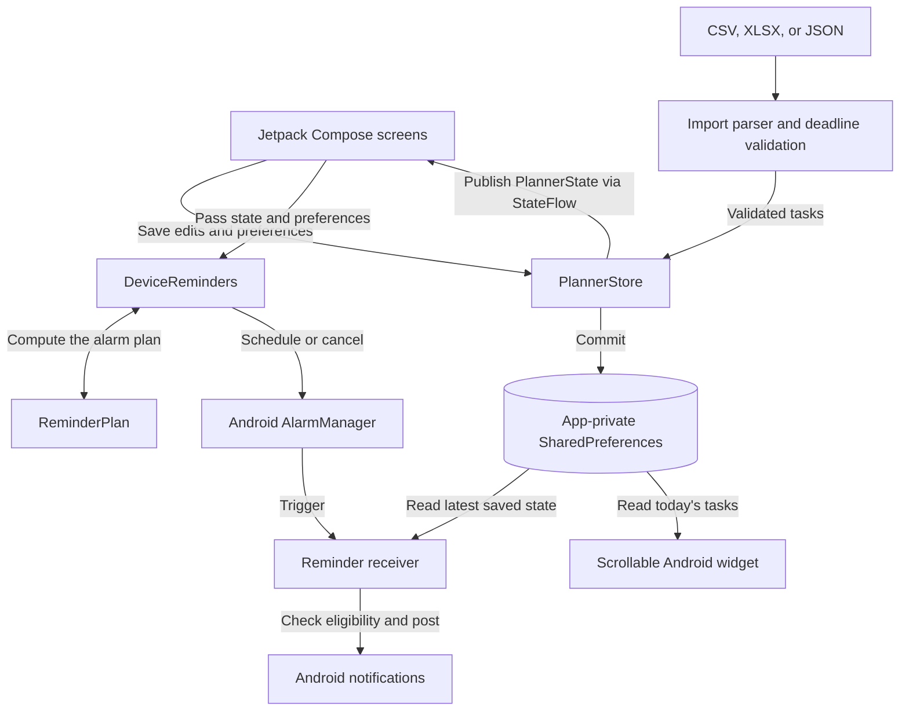

<p align="center">
  
</p>

<h1 align="center">Kaizen</h1>

<p align="center">An offline personal planner for daily to-dos, longer-term goals, and progress you can look back on.</p>

<p align="center">
  <a href="https://github.com/23-prabhat/kaizen/releases/latest"><strong>Download for Android</strong></a>
  · <a href="#using-kaizen">User guide</a>
  · <a href="#architecture">Architecture</a>
  · <a href="#development">Build from source</a>
</p>

## Why Kaizen?

Kaizen means “change for the better” and refers to improving through small, steady steps. I chose the name because making progress on a goal starts with deciding what you can do today. Dated to-dos give you a next step, progress notes let you record what changed, and History keeps completed and unfinished work visible when you plan again.

The interface follows that idea. The dashboard uses a retro planner style and an anime-inspired cat mascot, while the to-do and History screens use compact dated lists so tasks are easy to scan.

## Install on Android

1. Open the [latest GitHub release](https://github.com/23-prabhat/kaizen/releases/latest) on a phone running **Android 7.0 or later**.
2. Download the signed `.apk` from **Assets**, open it, and follow Android’s install prompts. Android may ask you to allow installation from your browser or file manager.
3. To update, install the new GitHub APK over the existing one. This keeps your planner and preferences.

The [v0.5.0 release](https://github.com/23-prabhat/kaizen/releases/tag/v0.5.0) is approximately **2.3 MiB** and includes a SHA-256 checksum. Kaizen opens directly to the dashboard with no account or backend setup.

## Using Kaizen

| Where | What you can do |
| --- | --- |
| **Dashboard** | See today’s completed and remaining work, a 14-day activity chart, and active goals. The bell opens a summary of pending work and upcoming goal deadlines, plus progress notes due today if their reminder is enabled. |
| **To-dos** | Add tasks for today, tomorrow, or a future date. Include an optional note and a deadline set by duration or clock time. |
| **Goals** | Choose a start and finish date or a number of days. Add a **Short term** or **Long term** tag and keep one progress note per day. |
| **History** | Revisit completed and unfinished tasks, along with their notes, on the dates you originally planned them for. |
| **Settings** | Control reminders, import tasks, choose a light, dark, or system theme, and use a fixed avatar or rotate through the built-in mascots and up to four of your own photos. |

The dashboard’s motivation line changes with the local date. The greeting and rotating avatar advance when the app starts or returns to the foreground. To add the scrollable **Today’s to-dos** widget, touch and hold an empty spot on the Android home screen, open **Widgets**, and select it under **Kaizen**. The widget shows both completed and open tasks. Tap its header to open today’s list.

### Deadlines and reminders

Enter **0–23 hours** and **0–59 minutes**, with a minimum duration of one minute, or choose a clock time. A duration starts when you save or import a task for today, and at local midnight for a future task. The deadline must end before midnight on the task’s date. If the plan exceeds that limit, the editor offers to start a goal with the same title.

Each reminder type is opt-in under **Settings → Notifications**. Times are local to the device.

| Reminder | When it’s scheduled |
| --- | --- |
| **Pending to-dos** | 7 PM if today’s list still has unfinished tasks. |
| **To-do deadlines** | Halfway through the available time and at the deadline, while the task remains unfinished. |
| **Goal deadlines** | 9 AM on the finish date for open goals, plus 9 AM the day before for goals spanning multiple days. |
| **Goal progress notes** | 8 PM if an active, unfinished goal is missing today’s note. |

On Android 13 and later, Kaizen requests notification permission when you enable reminders. On supported versions, **Allow precise deadline alerts** opens Android’s Alarms & reminders settings. Android may delay timed alerts when exact alarm access is unavailable.

### Bulk import

Go to **Settings → Planner data → Import Excel or CSV**. Use a UTF-8 CSV or the first worksheet of an Excel `.xlsx` file. Include the headers shown below. Use `YYYY-MM-DD` for dates, or use Excel date and time cells. A blank deadline makes the task all-day.

```csv
date,todo work,deadline
2026-11-16,Solve questions 1–10,4hr
2026-11-17,Solve questions 11–20,1hr 30 min
2026-11-18,Solve questions 21–30,30 min
2026-11-19,Review missed questions,5:30 PM
2026-11-20,Organize notes,
```

For JSON, select **Import JSON report** and use an array of tasks. The Android app also accepts the earlier Kaizen report format with `day`, `title`, and optional `id`, `note`, `done`, and `deadline` fields.

```json
[
  { "date": "2026-11-16", "todo work": "Solve questions 1–10", "deadline": "1hr 30 min" },
  { "id": "weekly-review", "day": "2026-11-20", "title": "Review the weekly plan", "note": "Check the next step for each goal.", "done": false }
]
```

Each file supports up to 5,000 to-dos. The file size limits are 2 MB for CSV and Excel, and 1 MB for JSON. Kaizen validates the entire file before saving and skips matching tasks on reimport, preserving edits you’ve already made. Imports can also populate past dates in History. Relative deadlines for those rows start at midnight on the recorded date.

## Architecture

The Android release is a single Kotlin and Jetpack Compose application. Compose observes a single planner state, while the widget and notification receiver can read saved data when the app screen is closed.



| Area | Responsibility | Code |
| --- | --- | --- |
| Presentation | Renders the dashboard, day and goal lists, and forms from the current state. Dashboard counts and chart totals are derived from saved entries. | [MainActivity.kt](native-android/app/src/main/java/com/daytabs/planner/MainActivity.kt), [Dashboard.kt](native-android/app/src/main/java/com/daytabs/planner/Dashboard.kt) |
| State and persistence | Stores tasks by calendar date, keeps goals and dated progress notes, and publishes successful writes to Compose. Can migrate supported local data from the earlier React Native Android app. | [PlannerStore.kt](native-android/app/src/main/java/com/daytabs/planner/PlannerStore.kt) |
| Dates and imports | Shares duration rules between the editor and bulk import. Validates a whole import before writing and uses stable row identifiers to deduplicate retries. | [PlannerDates.kt](native-android/app/src/main/java/com/daytabs/planner/PlannerDates.kt), [TodoDeadline.kt](native-android/app/src/main/java/com/daytabs/planner/TodoDeadline.kt), [TodoImport.kt](native-android/app/src/main/java/com/daytabs/planner/TodoImport.kt) |
| Android integrations | Calculates reminders from planner data and preferences, reconciles scheduled alarms, and re-checks state when an alarm fires. The home-screen widget uses Android’s `RemoteViews` collection to read and display today’s list. | [ReminderPlan.kt](native-android/app/src/main/java/com/daytabs/planner/ReminderPlan.kt), [DeviceFeatures.kt](native-android/app/src/main/java/com/daytabs/planner/DeviceFeatures.kt), [TodayWidget.kt](native-android/app/src/main/java/com/daytabs/planner/TodayWidget.kt) |

### Engineering decisions

- **Date and time are separate concepts.** A to-do belongs to a local calendar date, which keeps it on the same History page after midnight or a time-zone change. A timed deadline stores an instant and, when available, the start of its time window. That gives the halfway reminder a stable reference.
- **Reminders follow the current plan.** Editing a deadline, completing a task, or changing a reminder preference can change the scheduled alarms. Before posting, the receiver checks saved state again so an old alarm does not notify about work that is already complete. Android lifecycle events such as reboot and clock changes trigger rescheduling.
- **The Android port prioritized APK size and OS integration.** The project began with Expo. The Kotlin release removes the need to bundle the React Native runtime and connects directly to Android’s widget, alarm, and notification APIs. Code minification and resource shrinking keep the release compact while one APK covers both 32-bit and 64-bit Android architectures.
- **Persistence matches the scope of a personal planner.** One on-device store supports the dashboard, history, reminders, and widget without a network dependency. Records are serialized to JSON in app-private `SharedPreferences`, so changes to planner entries rewrite the records snapshot. This keeps the storage model simple for a personal planner.

### Storage and privacy

Kaizen saves tasks, goals, notes, preferences, and custom avatars on the device. There is no account, Supabase dependency, or live cross-device sync in the Android release. A new installation starts empty unless Android restores existing app data from a device backup.

## Development

| Path | Contents |
| --- | --- |
| [`native-android/`](native-android/) | Kotlin and Jetpack Compose app that produces the signed GitHub APK. |
| [`src/`](src/) | React Native and Expo implementation used for browser and device previews. Android release features are documented here against the Kotlin app. |
| [`assets/`](assets/) | Launcher icon, dashboard artwork, and mascot variants. |

### Native Android

Open `native-android/` in Android Studio, or use the included Gradle 9.4.1 wrapper. Install **JDK 17 or newer** and the **Android SDK API 37** platform. The app runs on API 24 and later. [Android Gradle Plugin compatibility](https://developer.android.com/build/releases/agp-9-2-0-release-notes#compatibility)

```sh
cd native-android
./gradlew :app:assembleDebug
./gradlew :app:lintRelease
```

The debug APK is generated in `app/build/outputs/apk/debug/`. With an emulator or Android device connected, use `./gradlew :app:installDebug`. Run `./gradlew :app:assembleRelease` to generate an unsigned APK in `app/build/outputs/apk/release/`. Updates distributed through GitHub use the same signing key as the existing APK.

### Expo preview

Use **Node.js 22.13+** within the Node 22 series, or **24.3+** within the Node 24 series. Run from the repository root.

```sh
npm ci
npm run web
npm run typecheck
```

| Command | Purpose |
| --- | --- |
| `npm start` | Start the Expo development server. |
| `npm run ios` | Build and run the iOS preview with Xcode on macOS. |
| `npm run android` | Build and run the Expo Android preview with the Android SDK. |
| `npm run demo -- --web --port 8082` | Run the loopback-only demo. |

Each browser profile has its own local planner. In the Expo preview, **Import report** accepts the earlier Kaizen JSON report format. To open the web preview from another device on the same Wi-Fi, run `EXPO_NO_DOTENV=1 npm run web -- --lan --port 8083` and open the LAN URL shown by Expo.

### Release verification

The v0.5.0 signed APK was tested on an Android 15 emulator. Checks covered upgrading from v0.4.0 with saved data, rejecting deadlines that reach midnight, importing CSV, XLSX, and JSON, and receiving the halfway notification for a 30-minute task.

## Project references

- [Product plan and design references](plan.md)
- [Logo and mascot artwork notes](assets/desk-cat.md)
- [Release notes and signed APKs](https://github.com/23-prabhat/kaizen/releases)
